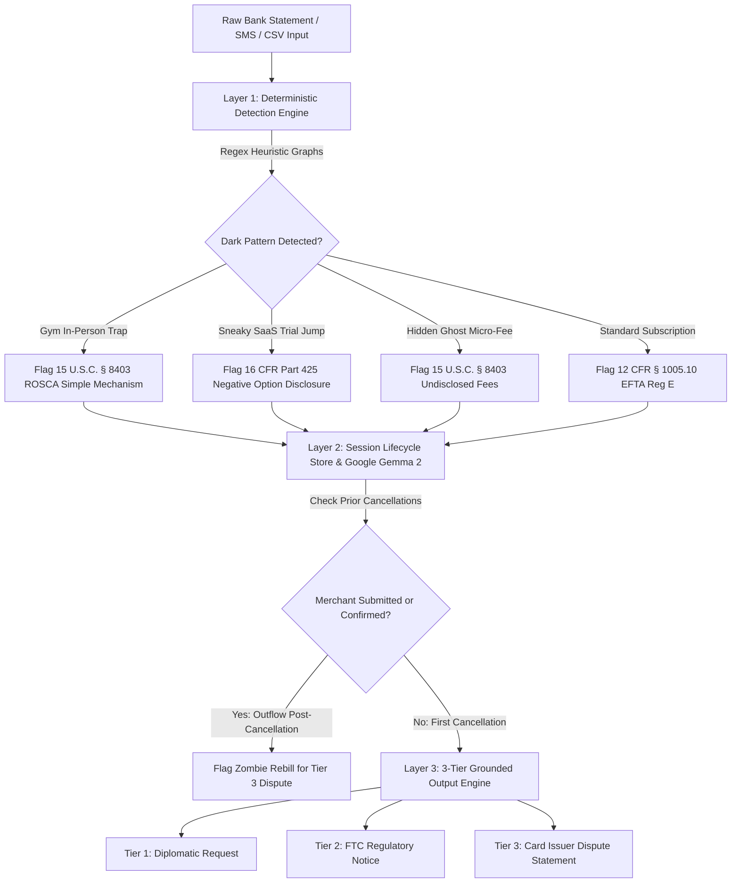

# SubSloth AI 🦥
### The Zombie Subscription & Dark Pattern Legal Canceller
*Built for Hacktoberfest 2026 Week 3: Slow & Steady (International Sloth Day)*

[](https://render.com)
[](https://opensource.org/licenses/MIT)
[](https://fastapi.tiangolo.com)
[](https://ai.google.dev/gemma)
[](https://www.ftc.gov)
[](https://pytest.org)

---

## 📌 The Pitch & The Problem

Consumers delay and procrastinate cancelling subscriptions because companies intentionally deploy **Dark Patterns** — multi-page retention funnels, forced customer support phone queues, and certified physical mail mandates. 

Because people are naturally inclined to conserve energy (*channeling our inner sloth!*), users delay cancelling gym memberships, trial conversions, and software tools for months. An average consumer loses **$35 to $80 per month ($420 to $960/year)** simply out of friction-induced procrastination.

When consumers try to cancel verbally or with emotional appeals (*"Please stop charging me, I can't afford this"*), retention desks stall. When consumers cite active statutory standards — specifically the **Restore Online Shoppers' Confidence Act (ROSCA, 15 U.S.C. § 8403)**, the **FTC Negative Option Framework (16 CFR Part 425)**, and **CFPB Regulation E (12 CFR § 1005.10)** — cancellation requests transition from emotional appeals into grounded, formal communications.

**SubSloth AI** is an open-source consumer tool that audits raw bank statements, credit card SMS logs, or transaction exports, flags recurring dark-pattern friction deterministically, and leverages **Google Gemma 2** to synthesize 3-tier user-reviewed cancellation letters and bank dispute drafts grounded in federal consumer protection standards.

---

## 🌐 Live Interactive Links

* 🚀 **Live Production App (Render):** [https://subsloth-ai.onrender.com/](https://subsloth-ai.onrender.com/)
* 📑 **Interactive OpenAPI Documentation:** [https://subsloth-ai.onrender.com/docs](https://subsloth-ai.onrender.com/docs)
* 🐙 **Open-Source Repository:** [https://github.com/diusazzad/subsloth-ai](https://github.com/diusazzad/subsloth-ai)

---

## 🦥 The Lazy Payoff (International Sloth Day Metrics)

SubSloth AI rewards laziness by quantifying exact friction eliminated:
* **Annualized Charges Identified:** Automatically calculates cumulative recurring drain ($450–$1,500/year).
* **Estimated Friction Avoided:** Highlights ~45 minutes of telephone retention bureaucracy per dark-pattern merchant.
* **3-Tier Grounded Escalation:** Prepares clear, user-reviewed cancellation and dispute drafts in seconds.

---

## 🏗️ 3-Layer Defense Pipeline Architecture



### 1. Layer 1: Deterministic Detection Engine (Python)
Before touching any LLM, incoming transaction text is audited against regex token graphs:
* **GYM_TRAP:** Detects gym chains (*Planet Fitness, Equinox, Gold's Gym*) requiring in-person visits or certified mail.
* **SNEAKY_SAAS_TRIAL:** Catches introductory rates and free trials converting to $79/mo recurring charges without affirmative consent.
* **GHOST_MICRO_FEE:** Catches undisclosed streaming addons ($1.99–$9.99) attached via drip pricing.

### 2. Layer 2: Session Lifecycle State & Google Gemma 2 Drafting
* **Session Lifecycle Store:** Tracks state per session (`DRAFT_GENERATED` -> `REQUEST_SUBMITTED` -> `CANCELLATION_CONFIRMED`). A draft alone does NOT flag unauthorized rebilling. Only once the user marks the notice sent or confirmed does a subsequent charge trigger an anti-zombie alert.
* **Google Gemma 2:** Prompts Gemma 2 via completion endpoint to author custom natural-language narrative blocks (`[DIPLOMATIC_BODY]` and `[DISPUTE_NARRATIVE]`). These model-generated blocks are directly embedded into Tier 1 and Tier 2/3 drafts.
* **Deterministic Statutory Guardrail:** All legal citations, dollar calculations, and statutory references remain governed by deterministic Python logic. If the model API times out or is unconfigured, the system automatically runs the deterministic fallback templates.

### 3. Layer 3: 3-Tier Grounded Escalation Engine
* **Tier 1 (Diplomatic Email):** Direct, courteous customer support cancellation request embedding Gemma's natural-language narrative.
* **Tier 2 (FTC Regulatory Notice):** Formal notice citing ROSCA (15 U.S.C. § 8403), FTC Act Section 5, and FTC Negative Option principles.
* **Tier 3 (Cardholder Dispute Statement):** Structured statement for card issuer dispute review under CFPB Regulation E (12 CFR § 1005.10(b)).

---

## ⚡ Zero-Click Benchmark Presets (For Judges)

The workbench interface features 4 zero-click benchmark buttons:
1. 🏋️‍♂️ **The Gym Trap:** Planet Fitness in-person cancellation barrier + annual maintenance fee.
2. 💻 **The Sneaky SaaS:** CloudScale AI 14-day trial auto-converted to $79/mo.
3. 👻 **The Ghost Micro-Fee:** StreamMax undisclosed 4K streaming addon ($4.99/mo).
4. 🦥 **Combined Sloth Audit:** Full statement dump totaling **$1,511.64/year** in identified annual charges and **3.0 hours** of estimated friction avoided.

---

## 🧪 Production Engineering: 20/20 Automated Pytest Suite

```text
============================= test session starts =============================
platform win32 -- Python 3.13.15, pytest-9.1.1, pluggy-1.7.0
collecting ... collected 20 items

test_subsloth.py::test_ftc_policy_clauses_completeness PASSED            [  5%]
test_subsloth.py::test_ftc_trigger_matching PASSED                       [ 10%]
test_subsloth.py::test_ftc_citation_formatting PASSED                    [ 15%]
test_subsloth.py::test_extract_amount_standard PASSED                    [ 20%]
test_subsloth.py::test_extract_amount_edge_cases PASSED                  [ 25%]
test_subsloth.py::test_detect_cadence_patterns PASSED                    [ 30%]
test_subsloth.py::test_identify_merchant_cleaning PASSED                 [ 35%]
test_subsloth.py::test_classify_gym_trap PASSED                          [ 40%]
test_subsloth.py::test_classify_sneaky_saas_trial PASSED                 [ 45%]
test_subsloth.py::test_classify_ghost_micro_fee PASSED                   [ 50%]
test_subsloth.py::test_classify_standard_subscription PASSED             [ 55%]
test_subsloth.py::test_audit_statement_empty_input PASSED                [ 60%]
test_subsloth.py::test_audit_statement_multi_item_calculation PASSED     [ 65%]
test_subsloth.py::test_cancellation_store_lifecycle_transitions PASSED   [ 70%]
test_subsloth.py::test_session_scoped_isolation PASSED                   [ 75%]
test_subsloth.py::test_gemma_model_response_meaningfully_used PASSED     [ 80%]
test_subsloth.py::test_gemma_deterministic_fallback_on_api_failure PASSED [ 85%]
test_subsloth.py::test_fastapi_endpoints_health_and_benchmarks PASSED    [ 90%]
test_subsloth.py::test_fastapi_audit_and_escalate_pipeline PASSED        [ 95%]
test_subsloth.py::test_fastapi_cancellation_lifecycle_endpoints PASSED   [100%]

============================= 20 passed in 0.53s ==============================
```

---

## ☁️ Sponsor Tooling & Track Alignment

1. **Best Use of Render ($200):** Native `render.yaml` Blueprint deployment, auto-sync, separate secret environment management (`sync: false`), and interactive FastAPI Swagger OpenAPI documentation (`/docs`).
2. **Best Use of Gemma ($200):** Google Gemma 2 model integration synthesizes custom diplomatic and dispute narratives bounded by deterministic regulatory guardrails and automated fallback.
3. **Grand Prize Track ($250):** Addresses the real-world procrastination problem on International Sloth Day with practical consumer protection tools.

---

## 🚀 Quickstart & Local Setup

```bash
# Clone the repository
git clone https://github.com/diusazzad/subsloth-ai.git
cd subsloth-ai

# Install dependencies
pip install -r requirements.txt

# Run automated tests
pytest -v test_subsloth.py

# Launch the FastAPI server
uvicorn main:app --reload --port 8000
```
Open [http://127.0.0.1:8000](http://127.0.0.1:8000) in your browser.

---

## 📜 License
MIT License. Open innovation for everyone.
