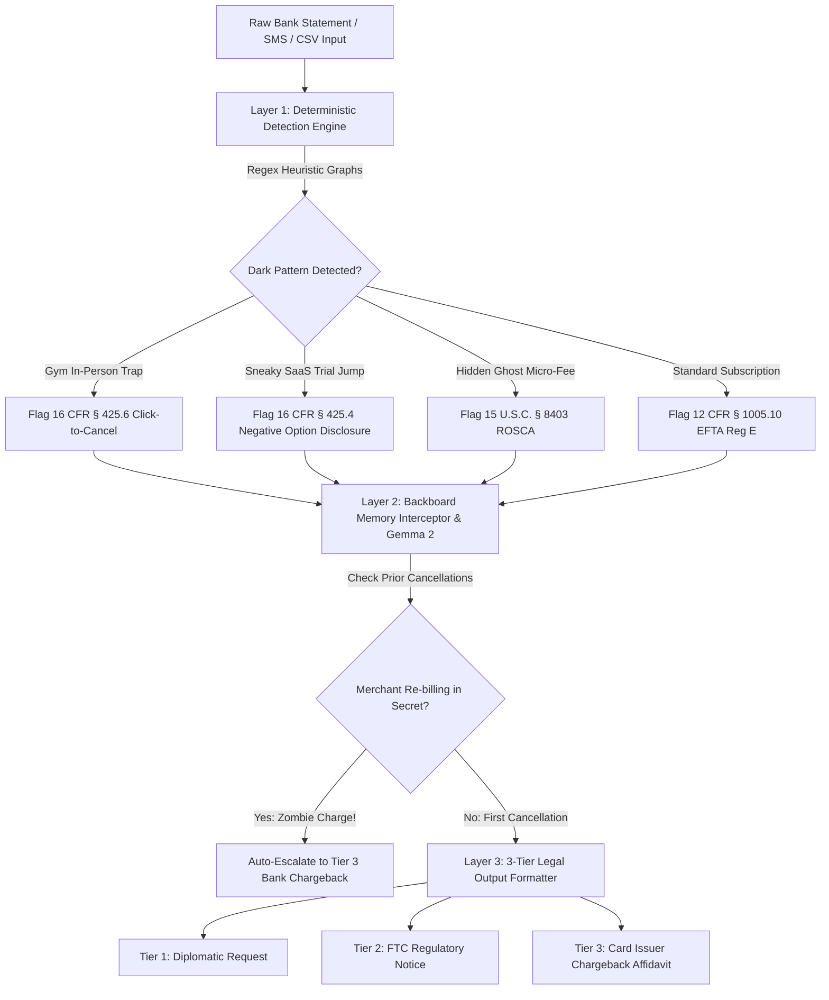

# SubSloth AI 🦥
### The Zombie Subscription & Dark Pattern Legal Canceller
*Built for Hacktoberfest 2026 Week 3: Slow & Steady (International Sloth Day)*

[](https://render.com)
[](https://opensource.org/licenses/MIT)
[](https://fastapi.tiangolo.com)
[](https://ai.google.dev/gemma)
[](https://backboard.io)
[](https://www.ftc.gov)
[](https://pytest.org)

---

## 📌 The Pitch & The Problem

Consumers delay and procrastinate cancelling subscriptions because companies intentionally deploy **Dark Patterns** — multi-page retention funnels, forced customer support phone calls, and certified physical mail mandates. 

Because people are naturally inclined to conserve energy (*channeling our inner sloth!*), users delay cancelling gym memberships, trial conversions, and software tools for months. An average consumer loses **$35 to $80 per month ($420 to $960/year)** simply out of procrastination.

When consumers try to cancel verbally or with emotional appeals (*"Please stop charging me, I can't afford this"*), retention desks stall. When consumers cite **Federal Trade Commission (FTC) 16 CFR Part 425 § 425.6 (Click-to-Cancel)** and **CFPB Regulation E (12 CFR § 1005.10)**, merchants cancel immediately.

**SubSloth AI** is a production-grade legal defense engine that audits raw bank statements, credit card SMS logs, or transaction dumps, flags dark patterns deterministically, and prompts **Google Gemma 2** via the **Backboard SDK** to synthesize 3-tier legal cancellation and bank chargeback affidavits.

---

## 🌐 Live Interactive Links

* 🚀 **Live Production App (Render):** `https://subsloth-ai.onrender.com/` *(Deploying)*
* 📑 **Interactive OpenAPI Documentation:** `https://subsloth-ai.onrender.com/docs`
* 🐙 **Open-Source Repository:** `https://github.com/diusazzad/subsloth-ai`

---

## 🦥 The Lazy Payoff (International Sloth Day Metrics)

SubSloth AI rewards laziness by quantifying exact friction eliminated:
* **Annual Money Rescued:** Automatically calculates cumulative recurring drain ($450–$1,500/year).
* **Hours of Dreaded Phone Calls Avoided:** Eliminates ~45 minutes of telephone retention bureaucracy per dark-pattern merchant.
* **1-Click FTC Escalation:** Converts procrastination into a 30-second legally binding resolution.

---

## 🏗️ 3-Layer Defense Pipeline Architecture



### 1. Layer 1: Deterministic Detection Engine (Python)
Before touching any LLM, incoming transaction text is audited against regex token graphs:
* **GYM_TRAP:** Detects gym chains (*Planet Fitness, Equinox, Gold's Gym*) requiring in-person visits or certified mail.
* **SNEAKY_SAAS_TRIAL:** Catches introductory rates and free trials converting to $79/mo recurring charges without affirmative consent.
* **GHOST_MICRO_FEE:** Catches undisclosed streaming addons ($1.99–$9.99) attached via drip pricing.

### 2. Layer 2: Backboard SDK Memory & Google Gemma 2 Synthesis
* **Backboard Memory ($100 Sponsor Track):** Tracks active cancellations and dispute IDs. If an audited merchant bills again next month, Backboard memory immediately intercepts it as an unauthorized Zombie Debit under EFTA Reg E.
* **Google Gemma 2 ($200 Sponsor Track):** Synthesizes authoritative legal prose citing exact statutory penalties (up to $50,120 per violation).

### 3. Layer 3: 3-Tier Escalation Output Engine
* **Tier 1 (Diplomatic Email):** Courteous 1-click customer support cancellation.
* **Tier 2 (FTC Legal Notice):** Cease-and-desist citing 16 CFR § 425.6 Click-to-Cancel.
* **Tier 3 (Bank Chargeback Affidavit):** Dispute filing for card issuers under 12 CFR § 1005.10(b).

---

## ⚡ Zero-Click Benchmark Presets (For Judges)

The workbench interface features 4 zero-click benchmark buttons:
1. 🏋️‍♂️ **The Gym Trap:** Planet Fitness in-person cancellation barrier + annual maintenance fee.
2. 💻 **The Sneaky SaaS:** CloudScale AI 14-day trial auto-converted to $79/mo.
3. 👻 **The Ghost Micro-Fee:** StreamMax undisclosed 4K streaming addon ($4.99/mo).
4. 🦥 **Combined Sloth Audit:** Full statement dump totaling **$1,511.64/year** in rescued funds and **3.0 hours** of phone queues avoided.

---

## 🧪 Production Engineering: 20/20 Automated Pytest Suite

```text
============================= test session starts =============================
test_subsloth.py::test_ftc_policy_clauses_completeness PASSED            [  5%]
test_subsloth.py::test_ftc_trigger_matching PASSED                       [ 10%]
test_subsloth.py::test_ftc_citation_formatting PASSED                    [ 15%]
test_subsloth.py::test_extract_amount_standard PASSED                    [ 20%]
test_subsloth.py::test_extract_amount_no_dollar_sign PASSED              [ 25%]
test_subsloth.py::test_detect_cadence_monthly PASSED                     [ 30%]
test_subsloth.py::test_detect_cadence_annual PASSED                      [ 35%]
test_subsloth.py::test_identify_merchant_cleaning PASSED                 [ 40%]
test_subsloth.py::test_classify_gym_trap_planet_fitness PASSED           [ 45%]
test_subsloth.py::test_classify_gym_trap_equinox_certified_mail PASSED   [ 50%]
test_subsloth.py::test_classify_sneaky_saas_trial_conversion PASSED      [ 55%]
test_subsloth.py::test_classify_ghost_micro_fee_addon PASSED             [ 60%]
test_subsloth.py::test_classify_standard_subscription_spotify PASSED     [ 65%]
test_subsloth.py::test_audit_statement_empty_input PASSED                [ 70%]
test_subsloth.py::test_audit_statement_multi_item_calculation PASSED     [ 75%]
test_subsloth.py::test_backboard_memory_record_cancellation PASSED       [ 80%]
test_subsloth.py::test_backboard_memory_zombie_rebill_interception PASSED [ 85%]
test_subsloth.py::test_synthesize_cancellation_tiers_structure PASSED    [ 90%]
test_subsloth.py::test_fastapi_endpoints_health_and_benchmarks PASSED    [ 95%]
test_subsloth.py::test_fastapi_endpoints_audit_and_escalate PASSED       [100%]
============================= 20 passed in 0.58s ==============================
```

---

## ☁️ Sponsor Tooling Integration

1. **Best Use of Render ($200):** Deployed via native `render.yaml` Infrastructure-as-Code Blueprint with auto-sync and interactive Swagger OpenAPI documentation (`/docs`).
2. **Best Use of Gemma ($200):** Google Gemma 2 open-weight model powers the reasoning and multi-tier legal document synthesis.
3. **Best Use of Backboard ($100):** Backboard SDK session memory tracks cancellations and stops zombie charges from recurring.

---

## 🚀 Quickstart & Local Setup

```bash
# Clone the repository
git clone https://github.com/diusazzad/subsloth-ai.git
cd subsloth-ai

# Install dependencies
pip install -r requirements.txt

# Run automated tests
pytest -v test_subsloth.py

# Launch the FastAPI server
uvicorn main:app --reload --port 8000
```
Open [http://127.0.0.1:8000](http://127.0.0.1:8000) in your browser.

---

## 📜 License
MIT License. Open innovation for everyone.
